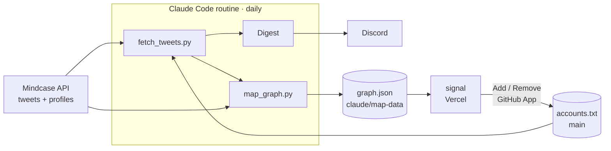

<h1 align="center">signal</h1>

<p align="center">
  <b>Who's worth following in AI.</b><br>
  A daily digest of a handpicked list of AI builders on X, and a living map of the people they keep relaying.
</p>

<p align="center">
  <a href="https://twitter-monitoring-site.vercel.app"><b>↘ Open the map</b></a>
  &nbsp;·&nbsp;
  <a href="https://raw.githubusercontent.com/paulvln1/twitter-monitoring/claude/map-data/graph/graph.json">Raw data</a>
  &nbsp;·&nbsp;
  <a href="docs/map-spec.md">Spec</a>
</p>

---

## Screenshots

<!--
  Screenshot slot: replace the image paths below with your screenshots,
  then delete this comment's opening and closing lines so they show up.

<p align="center">
  
</p>

| The map | An account |
|---|---|
|  |  |

| Discovered | Admin mode |
|---|---|
|  |  |
-->

## What it does

Every morning, a scheduled Claude Code routine reads the last 24 hours of tweets from a curated watchlist of AI and coding-agent builders (`accounts.txt`), then:

1. **Writes a digest** and posts it to Discord: new projects worth a look, one technical concept explained simply, notable takes, accounts to follow, and the cost of the run.
2. **Updates the map.** Every retweet, quote and reply from the watchlist is logged. An account that keeps getting relayed shows up on the map as a *discovery*, with a one-line note on why it matters.
3. **Lets the owner act on it.** Signed in with GitHub, the owner can add a discovery to the watchlist or remove a source, straight from the site.

The loop: sources surface people → the best ones get promoted to sources → they surface new people.

## How an account gets on the map

An account becomes a **discovery** when, over a rolling 30-day window:

- **at least 2 different tweets** of theirs were relayed, **and**
- **at least 2 different accounts** of the watchlist relayed them.

One viral tweet relayed by five sources still counts as one tweet: the rule rewards people who post good things regularly, not one-hit wonders. Retweets, quotes and replies count; mentions don't. Accounts already in the watchlist are never shown as discoveries.

## Architecture



| Piece | Role |
|---|---|
| `PROMPT.md` | Instructions for the daily routine: filtering, digest format, delivery order. |
| `fetch_tweets.py` | All tweet fetching via Mindcase, with cost guardrails (date filter on every call, stop if the first call looks wrong). Python stdlib only. |
| `post_discord.py` | Sends the digest to one or more Discord webhooks, one embed per section. `--dry-run` prints the payloads. |
| `map_graph.py` | The map engine: extracts interactions, applies the rules, fetches new profiles once, builds `graph.json`. Python stdlib only. |
| `update_map.sh` | `prepare` and `publish` steps for the routine. Pushes only to the `claude/map-data` branch, never to `main`. |
| `site/` | The static site (HTML, CSS, vanilla JS, d3). Reads `graph.json` straight from GitHub. |
| `site/api/` | Vercel functions for GitHub login and watchlist edits. No npm dependencies. |
| `map_seed/` | Interactions backfilled from the first Discord digests. |

## Security

The site is public; editing the watchlist is restricted to one admin.

- **GitHub login is used for identity only.** No repository scope is requested, and the OAuth token is revoked right after reading the login.
- **The session is a signed cookie** (`HttpOnly`, `Secure`, `SameSite=Strict`, 7 days). The admin list is checked again on every write.
- **Writes go through a dedicated GitHub App** installed on this repository only, with `Contents: write` as its only permission. The server code can only touch `accounts.txt`.
- **Handles are validated** against `^[A-Za-z0-9_]{1,15}$`, and write requests must come from the site's own origin.
- **The routine can't push to `main`.** Its data lives on `claude/map-data`, so a malicious tweet can't change the code the routine runs.

## Run it yourself

**Digest**, with the routine's environment variables:

```bash
export MINDCASE_API_KEY=...
export DISCORD_WEBHOOK_URL=...        # optional second channel: DISCORD_WEBHOOK_URL_2
python3 fetch_tweets.py
```

The routine needs network access to `api.mindcase.co` and `discord.com`.

**Map, locally:**

```bash
./update_map.sh prepare
python3 -m http.server
```

Then open `http://localhost:8000/site/index.html?data=/map-data/graph/graph.json`.

**Site on Vercel:** import the repository with Root Directory `site` and Framework `Other`. To enable login and editing, follow [`docs/admin-setup.md`](docs/admin-setup.md).

**Tests:**

```bash
python3 -m unittest discover tests
node --test tests/site_api.test.js
```

## Editing the watchlist

Use the **Add / Remove** buttons on the site, or edit [`accounts.txt`](accounts.txt) on GitHub: one handle per line, `#` for comments. The routine reads `main` on every run, so changes show up the next morning.

## Costs

Mindcase charges per row returned: about $0.00025 per tweet and $0.0005 per profile. Profiles are fetched once, when an account enters the map, and never refreshed. Each digest ends with the cost of its run.

---

<p align="center"><sub>Built with <a href="https://claude.com/claude-code">Claude Code</a> · data from <a href="https://mindcase.co">Mindcase</a></sub></p>
